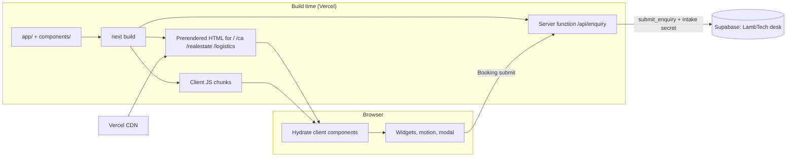
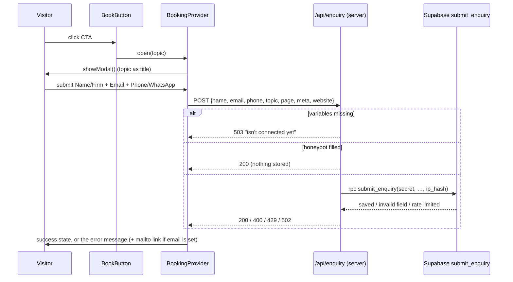

# LambTech Enquiries Implementation Plan

> **For agentic workers:** REQUIRED SUB-SKILL: Use superpowers:subagent-driven-development (recommended) or superpowers:executing-plans to implement this plan task-by-task. Steps use checkbox (`- [ ]`) syntax for tracking.

**Goal:** Every call-to-action form submitted on the LambTech website is saved as an enquiry in the desk's database, shown in the desk, and confirmed into a lead in one step.

**Architecture:** The website's server route calls one Supabase function, `submit_enquiry`, which is the only thing the public role may execute and which refuses callers without a server-held intake secret. Staff work enquiries in a new desk screen; `confirm_enquiry` atomically finds-or-creates the contact, creates the lead and marks the enquiry confirmed. Rules live in Postgres; the API and screens stay thin.

**Tech Stack:** Postgres (Supabase) · FastAPI + SQLAlchemy Core · React 19 + Vite + Tailwind 4 (desk) · Next.js 16.4 App Router + TypeScript (website) · pytest · Node's built-in test runner.

**Spec:** `docs/superpowers/specs/2026-11-13-lambtech-enquiries-design.md`

**Two repositories:**

| Short name | Path | Branch | Tasks |
|---|---|---|---|
| DESK | `C:\Users\BARNAK\Desktop\Lambtech` (`Xenomorph27/Lambtech_DB`) | `feat/enquiries` (exists) | 1–7 |
| SITE | `C:\Users\BARNAK\Desktop\Lambtech_website` (`Xenomorph27/Lambtech_website`) | `feat/enquiries` (create from `main`) | 8–11 |

DESK test command (run from the DESK root; start the database first with
`.\scripts\test-db.ps1 start` **from an interactive terminal**):
`backend/.venv/Scripts/python.exe -m pytest backend/tests -q`

## Global Constraints

- All three form fields are required: Name / Firm, Email, Phone / WhatsApp.
- Every `citext` reference in SQL is written `extensions.citext`.
- Migrations are append-only once pushed. This plan adds exactly one file, `supabase/migrations/20261113090000_enquiries.sql`, built up over Tasks 1–3 and pushed only in Task 12.
- New tables get RLS enabled and explicit `revoke all ... from anon, authenticated`; new functions get `revoke all ... from public, anon, authenticated`. The single grant is `execute` on `submit_enquiry` to `anon`.
- No secret is committed or printed into chat: the intake secret exists only in the website's Vercel environment; only its SHA-256 goes into the database.
- SITE: read the bundled Next.js docs before writing route code (`node_modules/next/dist/docs/01-app/01-getting-started/15-route-handlers.md`). `next.config.ts` has `cacheComponents: true`, so **do not export route segment config** (`dynamic`, `runtime`, …) from the route file.
- SITE: `architecture.md` is updated in the same change as the code (Task 11).
- Enquiries screen hue: `#ffb03a`. Sidebar: first item of the Pipeline group.
- Commit messages end with `Co-Authored-By: Claude Fable 5.2 <noreply@anthropic.com>`.
- Nothing is pushed to `main`, and `db push` is not run, before Task 12.

## Review Focus

1. A caller holding only the public key (no intake secret, or a wrong one, or a forged `ip_hash`) → refused; nothing stored. (Task 2)
2. Phone numbers as people type them — `+91 98765-43210`, `(022) 2345 6789` — accepted; `12345` refused. (Task 2, Task 8)
3. Confirming an enquiry whose email differs only by case or stray spaces from an existing contact → that contact is reused, not duplicated. (Task 3)
4. Confirm pressed twice → exactly one lead; the second is refused with a readable message. (Task 3, Task 4)
5. A confirmed enquiry cannot be reopened while its lead exists, and can once the lead is deleted. (Task 1)

---

### Task 1: Enquiries table, intake keys, lead link, status rules

**Files:**
- Create: `supabase/migrations/20261113090000_enquiries.sql`
- Modify: `backend/tests/conftest.py` (move `as_role` here, add `make_enquiry`)
- Modify: `backend/tests/test_rls.py` (import `as_role`; add the two tables)
- Test: `backend/tests/test_enquiries.py`

**Interfaces:**
- Produces: table `enquiries(id, created_at, updated_at, name, email, phone, topic, page, meta, ip_hash, status, notes, contact_id, handled_at)`; enum `enquiry_status`; table `enquiry_intake_keys(sha256, label, created_at)`; column `leads.enquiry_id` (unique); `leads_view` now includes `enquiry_id`; test helpers `as_role(db, role, sql, params=None)` and `make_enquiry(conn, **values)` in `conftest.py`.

- [ ] **Step 1: Move `as_role` into conftest and add `make_enquiry`**

Append to `backend/tests/conftest.py` (after `make_transaction`):

```python
def make_enquiry(conn, **values):
    return insert(
        conn,
        "enquiries",
        **{"name": "Priya, Sharma & Co.", "email": "priya@sharma.in", "phone": "+91 98765 43210", **values},
    )


def as_role(db, role, sql, params=None):
    """Run one statement as a Supabase API role, then switch back."""
    with db.cursor() as cur:
        cur.execute(f"set role {role}")
        try:
            cur.execute(sql, params)
            return cur.fetchall() if cur.description else []
        finally:
            cur.execute("reset role")
```

In `backend/tests/test_rls.py`: delete its own `as_role` function, change the import line to
`from conftest import as_role, make_contact, one, rows`, and add `"enquiries"` and
`"enquiry_intake_keys"` to the end of `TABLES`.

- [ ] **Step 2: Write the failing tests**

Create `backend/tests/test_enquiries.py`:

```python
"""Website enquiries: table, status rules, intake, confirm (spec 2026-11-13)."""

import psycopg2.errors as pg
import pytest

from conftest import insert, make_contact, make_enquiry, make_lead, make_response, make_email, one, rows


def set_status(db, enquiry, status):
    return one(db, "update enquiries set status = %s where id = %s returning *", [status, enquiry["id"]])


# --- table and rules -----------------------------------------------------------


def test_enquiry_defaults(db):
    e = make_enquiry(db)
    assert (e["status"], e["meta"], e["handled_at"], e["contact_id"]) == ("new", {}, None, None)


def test_enquiry_email_trimmed(db):
    assert make_enquiry(db, email="  Priya@Sharma.in ")["email"] == "Priya@Sharma.in"


def test_handled_at_set_when_leaving_new(db):
    e = make_enquiry(db)
    assert set_status(db, e, "contacted")["handled_at"] is not None


def test_cannot_insert_as_confirmed(db):
    with pytest.raises(pg.RaiseException):
        make_enquiry(db, status="confirmed")


def test_cannot_mark_confirmed_without_a_lead(db):
    e = make_enquiry(db)
    with pytest.raises(pg.RaiseException):
        set_status(db, e, "confirmed")


def test_lead_links_to_one_enquiry_only(db):
    contact = make_contact(db)
    e = make_enquiry(db)
    make_lead(db, contact, enquiry_id=e["id"])
    with pytest.raises(pg.UniqueViolation):
        make_lead(db, contact, enquiry_id=e["id"])


def test_lead_has_one_origin(db):
    contact = make_contact(db)
    response = make_response(db, make_email(db, contact))
    e = make_enquiry(db)
    with pytest.raises(pg.CheckViolation):
        make_lead(db, contact, enquiry_id=e["id"], response_id=response["id"])


def test_delete_enquiry_with_lead_blocked(db):
    e = make_enquiry(db)
    make_lead(db, make_contact(db), enquiry_id=e["id"])
    with pytest.raises(pg.RestrictViolation):
        rows(db, "delete from enquiries where id = %s", [e["id"]])


def test_confirmed_enquiry_reopens_only_after_its_lead_is_gone(db):
    e = make_enquiry(db)
    lead = make_lead(db, make_contact(db), enquiry_id=e["id"])
    set_status(db, e, "confirmed")  # allowed: a lead points at it
    with pytest.raises(pg.RaiseException):
        set_status(db, e, "contacted")
    rows(db, "delete from leads where id = %s", [lead["id"]])
    assert set_status(db, e, "contacted")["status"] == "contacted"


def test_leads_view_shows_enquiry_id(db):
    e = make_enquiry(db)
    lead = make_lead(db, make_contact(db), enquiry_id=e["id"])
    assert one(db, "select enquiry_id from leads_view where id = %s", [lead["id"]])["enquiry_id"] == e["id"]


def test_intake_keys_table_exists(db):
    insert(db, "enquiry_intake_keys", sha256="ab" * 32, label="test")
    assert one(db, "select count(*) as n from enquiry_intake_keys")["n"] == 1
```

- [ ] **Step 3: Run to verify failure**

Run: `backend/.venv/Scripts/python.exe -m pytest backend/tests/test_enquiries.py -q`
Expected: every test FAILS with `relation "enquiries" does not exist` (or `column "enquiry_id" ... does not exist`).

- [ ] **Step 4: Write the migration**

Create `supabase/migrations/20261113090000_enquiries.sql`:

```sql
-- LambTech Desk: website enquiries (spec 2026-11-13).
--
-- A visitor submits the website form -> one row here (status 'new').
-- Staff confirm it -> confirm_enquiry() creates the contact and the lead.
-- The public reaches this schema through exactly one function,
-- submit_enquiry(), which refuses callers without the intake secret.

-- ---------------------------------------------------------------------------
-- Table
-- ---------------------------------------------------------------------------

create type enquiry_status as enum ('new', 'contacted', 'confirmed', 'rejected', 'spam');

create table enquiries (
  id         uuid primary key default gen_random_uuid(),
  created_at timestamptz not null default now(),
  updated_at timestamptz not null default now(),
  name       text not null,
  email      extensions.citext not null,
  phone      text not null,
  topic      text,
  page       text,
  meta       jsonb not null default '{}'::jsonb,
  ip_hash    text,
  status     enquiry_status not null default 'new',
  notes      text,
  contact_id uuid references contacts (id) on delete set null,
  handled_at timestamptz
);
create index enquiries_status_created_idx on enquiries (status, created_at desc);
create index enquiries_ip_hash_created_idx on enquiries (ip_hash, created_at desc);

-- SHA-256 hashes of the secrets the website's server may present.
-- The secrets themselves are never stored.
create table enquiry_intake_keys (
  sha256     text primary key,
  label      text,
  created_at timestamptz not null default now()
);

-- A lead may come from an enquiry or from a positive reply, never both.
alter table leads
  add column enquiry_id uuid unique references enquiries (id) on delete restrict;
alter table leads
  add constraint leads_one_origin check (response_id is null or enquiry_id is null);

-- The view lists its columns when created, so it is rebuilt to pick up enquiry_id.
drop view leads_view;
create view leads_view with (security_invoker = true) as
select l.*,
       c.full_name,
       c.email,
       c.phone,
       c.company_id,
       co.name as company_name
  from leads l
  join contacts c on c.id = l.contact_id
  left join companies co on co.id = c.company_id;

-- ---------------------------------------------------------------------------
-- Status rules
-- ---------------------------------------------------------------------------

create or replace function enquiries_before_write() returns trigger
language plpgsql as $$
declare
  has_lead boolean;
begin
  if tg_op = 'INSERT' then
    if new.status = 'confirmed' then
      raise exception 'An enquiry is confirmed with the Confirm action, which creates its lead'
        using errcode = 'P0001';
    end if;
    return new;
  end if;

  if new.status is distinct from old.status then
    has_lead := exists (select from leads where enquiry_id = new.id);
    if new.status = 'confirmed' and not has_lead then
      raise exception 'An enquiry is confirmed with the Confirm action, which creates its lead'
        using errcode = 'P0001';
    end if;
    if old.status = 'confirmed' and has_lead then
      raise exception 'This enquiry has a lead; close the lead instead'
        using errcode = 'P0001';
    end if;
    if old.status = 'new' and new.handled_at is null then
      new.handled_at := now();
    end if;
  end if;
  return new;
end $$;

create trigger enquiries_00_trim before insert or update on enquiries
  for each row execute function trim_email_columns('email');
create trigger enquiries_10_before_write before insert or update on enquiries
  for each row execute function enquiries_before_write();
create trigger enquiries_90_updated_at before update on enquiries
  for each row execute function set_updated_at();

-- ---------------------------------------------------------------------------
-- Security: nothing for the API roles
-- ---------------------------------------------------------------------------

alter table enquiries           enable row level security;
alter table enquiry_intake_keys enable row level security;

revoke all on table enquiries, enquiry_intake_keys, leads_view from anon, authenticated;
revoke all on function enquiries_before_write() from public, anon, authenticated;
```

- [ ] **Step 5: Run the whole suite**

Run: `backend/.venv/Scripts/python.exe -m pytest backend/tests -q`
Expected: all pass (106 existing + 11 new + 4 new parametrized RLS cases = 121).

- [ ] **Step 6: Commit**

```bash
git add supabase/migrations/20261113090000_enquiries.sql backend/tests/conftest.py backend/tests/test_rls.py backend/tests/test_enquiries.py
git commit -m "feat(db): enquiries table, intake keys, lead link and status rules"
```

---

### Task 2: `submit_enquiry` — the one public entry point

**Files:**
- Modify: `supabase/migrations/20261113090000_enquiries.sql` (append)
- Test: `backend/tests/test_enquiries.py` (append)

**Interfaces:**
- Consumes: `enquiries`, `enquiry_intake_keys`, `as_role` (Task 1).
- Produces: `submit_enquiry(p_secret text, p_name text, p_email text, p_phone text, p_topic text default null, p_page text default null, p_meta jsonb default '{}', p_ip_hash text default null) returns void`. Failure messages (SQLSTATE `P0001`): exactly `intake_refused`, `rate_limited`, or `invalid_enquiry: <field>` where field ∈ `name|email|phone|topic|page|meta`. Executable by `anon` only.

- [ ] **Step 1: Write the failing tests**

Append to `backend/tests/test_enquiries.py`:

```python
# --- submit_enquiry: the public entry point ------------------------------------

import hashlib  # noqa: E402

from psycopg2.extras import Json  # noqa: E402

from conftest import as_role  # noqa: E402

SECRET = "test-intake-secret"
GOOD = dict(
    secret=SECRET,
    name="Priya, Sharma & Co.",
    email="priya@sharma.in",
    phone="+91 98765 43210",
    topic="Book a 15-minute discovery audit",
    page="/ca",
    meta={"referrer": "https://google.com/"},
    ip="ip-hash-1",
)


def register_key(db, secret=SECRET):
    insert(db, "enquiry_intake_keys", sha256=hashlib.sha256(secret.encode()).hexdigest(), label="test")


def submit(db, role="anon", **over):
    a = {**GOOD, **over}
    return as_role(
        db,
        role,
        "select submit_enquiry(%s, %s, %s, %s, %s, %s, %s, %s)",
        [a["secret"], a["name"], a["email"], a["phone"], a["topic"], a["page"], Json(a["meta"]), a["ip"]],
    )


def refused(db, message, **over):
    with pytest.raises(pg.RaiseException) as err:
        submit(db, **over)
    assert message in str(err.value)
    assert one(db, "select count(*) as n from enquiries")["n"] == 0


def test_submit_stores_a_new_enquiry(db):
    register_key(db)
    submit(db, name="  Priya, Sharma & Co. ", email=" Priya@Sharma.in ")
    e = one(db, "select * from enquiries")
    assert (e["name"], e["email"], e["phone"]) == ("Priya, Sharma & Co.", "Priya@Sharma.in", "+91 98765 43210")
    assert (e["topic"], e["page"], e["status"]) == ("Book a 15-minute discovery audit", "/ca", "new")
    assert e["meta"] == {"referrer": "https://google.com/"}
    assert e["ip_hash"] == "ip-hash-1"


def test_submit_without_a_registered_key_is_refused(db):
    refused(db, "intake_refused")


@pytest.mark.parametrize("secret", ["wrong-secret", "", None])
def test_submit_with_a_wrong_secret_is_refused(db, secret):
    register_key(db)
    refused(db, "intake_refused", secret=secret, ip="forged-ip-hash")


@pytest.mark.parametrize(
    "field, value",
    [
        ("name", "   "),
        ("name", "x" * 201),
        ("email", "not-an-email"),
        ("email", "a@b"),
        ("email", "x" * 250 + "@a.in"),
        ("phone", "12345"),
        ("phone", "9" * 16),
        ("phone", "call me maybe"),
        ("topic", "t" * 201),
        ("page", "/" + "p" * 300),
        ("meta", {"big": "x" * 3000}),
    ],
)
def test_submit_rejects_invalid_fields(db, field, value):
    register_key(db)
    refused(db, f"invalid_enquiry: {field}", **{field: value})


@pytest.mark.parametrize("phone", ["+91 98765-43210", "(022) 2345 6789", "9876543210"])
def test_submit_accepts_phones_as_people_type_them(db, phone):
    register_key(db)
    submit(db, phone=phone)
    assert one(db, "select phone from enquiries")["phone"] == phone


def test_sixth_enquiry_in_an_hour_from_one_address_is_refused(db):
    register_key(db)
    for i in range(5):
        submit(db, email=f"person{i}@firm.in")
    with pytest.raises(pg.RaiseException) as err:
        submit(db, email="person6@firm.in")
    assert "rate_limited" in str(err.value)
    submit(db, email="other@firm.in", ip="ip-hash-2")  # a different address is unaffected
    assert one(db, "select count(*) as n from enquiries")["n"] == 6


def test_double_submit_stores_one_row(db):
    register_key(db)
    submit(db)
    submit(db, email="PRIYA@sharma.in")  # same person, same button, seconds later
    assert one(db, "select count(*) as n from enquiries")["n"] == 1
    submit(db, topic="Test Our Parser on 5 Sample BoLs")  # a different button is a new enquiry
    assert one(db, "select count(*) as n from enquiries")["n"] == 2


def test_only_anon_may_call_submit(db):
    register_key(db)
    with pytest.raises(pg.InsufficientPrivilege):
        submit(db, role="authenticated")


def test_anon_still_cannot_read_what_it_submitted(db):
    register_key(db)
    submit(db)
    with pytest.raises(pg.InsufficientPrivilege):
        as_role(db, "anon", "select * from enquiries")
```

- [ ] **Step 2: Run to verify failure**

Run: `backend/.venv/Scripts/python.exe -m pytest backend/tests/test_enquiries.py -q -k "submit or sixth or anon"`
Expected: FAIL with `function submit_enquiry(...) does not exist`.

- [ ] **Step 3: Append the function to the migration**

Append to `supabase/migrations/20261113090000_enquiries.sql`:

```sql

-- ---------------------------------------------------------------------------
-- submit_enquiry: the one thing the public role may execute
-- ---------------------------------------------------------------------------

create or replace function submit_enquiry(
  p_secret  text,
  p_name    text,
  p_email   text,
  p_phone   text,
  p_topic   text  default null,
  p_page    text  default null,
  p_meta    jsonb default '{}'::jsonb,
  p_ip_hash text  default null
) returns void
language plpgsql
security definer
set search_path = public, extensions, pg_temp
as $$
declare
  v_name  text  := btrim(coalesce(p_name, ''));
  v_email text  := btrim(coalesce(p_email, ''));
  v_phone text  := btrim(coalesce(p_phone, ''));
  v_topic text  := nullif(btrim(coalesce(p_topic, '')), '');
  v_page  text  := nullif(btrim(coalesce(p_page, '')), '');
  v_meta  jsonb := coalesce(p_meta, '{}'::jsonb);
  v_digits integer;
begin
  -- Only the website's server knows the secret; the public key alone is not enough.
  if p_secret is null or not exists (
    select from enquiry_intake_keys
     where sha256 = encode(sha256(convert_to(p_secret, 'UTF8')), 'hex')
  ) then
    raise exception 'intake_refused' using errcode = 'P0001';
  end if;

  if char_length(v_name) not between 1 and 200 then
    raise exception 'invalid_enquiry: name' using errcode = 'P0001';
  end if;
  if char_length(v_email) > 254 or v_email !~ '^[^@\s]+@[^@\s]+\.[^@\s]+$' then
    raise exception 'invalid_enquiry: email' using errcode = 'P0001';
  end if;
  v_digits := char_length(regexp_replace(v_phone, '\D', '', 'g'));
  if char_length(v_phone) > 30 or v_digits not between 7 and 15 then
    raise exception 'invalid_enquiry: phone' using errcode = 'P0001';
  end if;
  if char_length(coalesce(v_topic, '')) > 200 then
    raise exception 'invalid_enquiry: topic' using errcode = 'P0001';
  end if;
  if char_length(coalesce(v_page, '')) > 300 then
    raise exception 'invalid_enquiry: page' using errcode = 'P0001';
  end if;
  if jsonb_typeof(v_meta) <> 'object' or octet_length(v_meta::text) > 2048 then
    raise exception 'invalid_enquiry: meta' using errcode = 'P0001';
  end if;

  -- A double click or a retried request: the first row stands.
  if exists (
    select from enquiries
     where email = v_email::extensions.citext
       and topic is not distinct from v_topic
       and created_at > now() - interval '10 minutes'
  ) then
    return;
  end if;

  if p_ip_hash is not null and (
    select count(*) from enquiries
     where ip_hash = p_ip_hash and created_at > now() - interval '1 hour'
  ) >= 5 then
    raise exception 'rate_limited' using errcode = 'P0001';
  end if;

  insert into enquiries (name, email, phone, topic, page, meta, ip_hash)
  values (v_name, v_email, v_phone, v_topic, v_page, v_meta, p_ip_hash);
end $$;

revoke all on function submit_enquiry(text, text, text, text, text, text, jsonb, text)
  from public, anon, authenticated;
grant execute on function submit_enquiry(text, text, text, text, text, text, jsonb, text) to anon;
```

- [ ] **Step 4: Run the whole suite**

Run: `backend/.venv/Scripts/python.exe -m pytest backend/tests -q`
Expected: all pass.

- [ ] **Step 5: Commit**

```bash
git add supabase/migrations/20261113090000_enquiries.sql backend/tests/test_enquiries.py
git commit -m "feat(db): submit_enquiry, the secret-gated public intake function"
```

---

### Task 3: `confirm_enquiry` and erasure

**Files:**
- Modify: `supabase/migrations/20261113090000_enquiries.sql` (append)
- Test: `backend/tests/test_enquiries.py` (append)

**Interfaces:**
- Consumes: Task 1 tables; existing `anonymize_contact(uuid)`.
- Produces: `confirm_enquiry(p_enquiry_id uuid, p_full_name text, p_email text, p_phone text, p_company_id uuid default null, p_job_title text default null, p_priority lead_priority default 'warm', p_description text default null) returns uuid` (the new lead's id). Errors: SQLSTATE `P0002` "Enquiry not found"; `P0001` "This enquiry is already confirmed" / "This enquiry is marked as spam; change its status first". `anonymize_contact` also blanks enquiries.

- [ ] **Step 1: Write the failing tests**

Append to `backend/tests/test_enquiries.py`:

```python
# --- confirm_enquiry -----------------------------------------------------------


def confirm(db, enquiry, full_name="Priya Sharma", email="priya@sharma.in", phone="+91 98765 43210", **extra):
    names = ["p_enquiry_id", "p_full_name", "p_email", "p_phone", *[f"p_{k}" for k in extra]]
    marks = ", ".join(f"{n} => %s" for n in names)
    return one(
        db,
        f"select confirm_enquiry({marks}) as lead_id",
        [enquiry["id"], full_name, email, phone, *extra.values()],
    )["lead_id"]


def test_confirm_creates_contact_and_lead(db):
    e = make_enquiry(db, topic="Book a call", page="/ca")
    lead_id = confirm(db, e)

    lead = one(db, "select * from leads where id = %s", [lead_id])
    contact = one(db, "select * from contacts where id = %s", [lead["contact_id"]])
    after = one(db, "select * from enquiries where id = %s", [e["id"]])

    assert (lead["enquiry_id"], lead["priority"], lead["status"], lead["description"]) == (e["id"], "warm", "new", "Book a call")
    assert lead["serial_no"] == "LT-0001"
    assert (contact["full_name"], contact["email"], contact["phone"]) == ("Priya Sharma", "priya@sharma.in", "+91 98765 43210")
    assert (contact["source"], contact["source_detail"]) == ("inbound_form", "Book a call · /ca")
    assert (after["status"], after["contact_id"]) == ("confirmed", contact["id"])
    assert after["handled_at"] is not None


def test_confirm_takes_priority_description_company_and_title(db):
    company = insert(db, "companies", name="Sharma & Co.")
    e = make_enquiry(db)
    lead_id = confirm(db, e, company_id=company["id"], job_title="Partner", priority="hot", description="Wants 2B recon")
    lead = one(db, "select * from leads_view where id = %s", [lead_id])
    assert (lead["priority"], lead["description"], lead["company_name"]) == ("hot", "Wants 2B recon", "Sharma & Co.")


def test_confirm_reuses_an_existing_contact_ignoring_case_and_spaces(db):
    existing = make_contact(db, full_name="Priya S.", email="priya@sharma.in", phone=None)
    e = make_enquiry(db)
    lead_id = confirm(db, e, full_name="Someone Else", email="  PRIYA@Sharma.in ", phone="+91 98765 43210")

    assert one(db, "select count(*) as n from contacts")["n"] == 1
    contact = one(db, "select * from contacts where id = %s", [existing["id"]])
    assert contact["full_name"] == "Priya S."  # an existing contact keeps its details
    assert contact["phone"] == "+91 98765 43210"  # ... except an empty phone is filled
    assert one(db, "select contact_id from leads where id = %s", [lead_id])["contact_id"] == existing["id"]


def test_confirm_does_not_overwrite_an_existing_phone(db):
    make_contact(db, email="priya@sharma.in", phone="111")
    confirm(db, make_enquiry(db), phone="222")
    assert one(db, "select phone from contacts")["phone"] == "111"


def test_confirm_twice_gives_one_lead(db):
    e = make_enquiry(db)
    confirm(db, e)
    with pytest.raises(pg.RaiseException) as err:
        confirm(db, e)
    assert "already confirmed" in str(err.value)
    assert one(db, "select count(*) as n from leads")["n"] == 1


def test_confirm_refuses_spam(db):
    e = make_enquiry(db)
    set_status(db, e, "spam")
    with pytest.raises(pg.RaiseException):
        confirm(db, e)
    assert one(db, "select count(*) as n from leads")["n"] == 0


def test_confirm_unknown_enquiry(db):
    with pytest.raises(pg.NoDataFound):
        confirm(db, {"id": "00000000-0000-0000-0000-000000000000"})


@pytest.mark.parametrize("role", ["anon", "authenticated"])
def test_api_roles_cannot_confirm(db, role):
    e = make_enquiry(db)
    with pytest.raises(pg.InsufficientPrivilege):
        as_role(db, role, "select confirm_enquiry(%s, 'A', 'a@b.in', '9876543210')", [e["id"]])


def test_anonymize_blanks_the_persons_enquiries(db):
    e = make_enquiry(db, notes="called twice", meta={"referrer": "x"}, ip_hash="h")
    lead_id = confirm(db, e)
    stray = make_enquiry(db, email="PRIYA@sharma.in", topic="Another button")  # same person, never confirmed
    contact_id = one(db, "select contact_id from leads where id = %s", [lead_id])["contact_id"]

    rows(db, "select anonymize_contact(%s)", [contact_id])

    for enquiry_id in (e["id"], stray["id"]):
        after = one(db, "select * from enquiries where id = %s", [enquiry_id])
        assert after["name"] == "Erased" and "sharma" not in after["email"].lower()
        assert (after["phone"], after["meta"], after["notes"], after["ip_hash"]) == ("erased", {}, None, None)
    assert one(db, "select count(*) as n from enquiries")["n"] == 2  # rows are kept
```

- [ ] **Step 2: Run to verify failure**

Run: `backend/.venv/Scripts/python.exe -m pytest backend/tests/test_enquiries.py -q -k "confirm or anonymize"`
Expected: FAIL with `function confirm_enquiry(...) does not exist`; the anonymize test fails on `after["name"] == "Erased"`.

- [ ] **Step 3: Append to the migration**

Append to `supabase/migrations/20261113090000_enquiries.sql`:

```sql

-- ---------------------------------------------------------------------------
-- confirm_enquiry: enquiry -> contact (found or created) + lead, atomically
-- ---------------------------------------------------------------------------

create or replace function confirm_enquiry(
  p_enquiry_id  uuid,
  p_full_name   text,
  p_email       text,
  p_phone       text,
  p_company_id  uuid          default null,
  p_job_title   text          default null,
  p_priority    lead_priority default 'warm',
  p_description text          default null
) returns uuid
language plpgsql as $$
declare
  e       enquiries%rowtype;
  v_email extensions.citext := btrim(p_email);
  v_phone text := nullif(btrim(coalesce(p_phone, '')), '');
  c_id    uuid;
  l_id    uuid;
begin
  -- The row lock makes two simultaneous confirms take turns.
  select * into e from enquiries where id = p_enquiry_id for update;
  if e.id is null then
    raise exception 'Enquiry not found' using errcode = 'P0002';
  end if;
  if e.status = 'confirmed' then
    raise exception 'This enquiry is already confirmed' using errcode = 'P0001';
  end if;
  if e.status = 'spam' then
    raise exception 'This enquiry is marked as spam; change its status first' using errcode = 'P0001';
  end if;

  select id into c_id from contacts where email = v_email;
  if c_id is null then
    insert into contacts (company_id, full_name, email, phone, job_title, source, source_detail)
    values (p_company_id, btrim(p_full_name), v_email, v_phone,
            nullif(btrim(coalesce(p_job_title, '')), ''),
            'inbound_form', nullif(concat_ws(' · ', e.topic, e.page), ''))
    returning id into c_id;
  else
    -- Someone we already know: keep their record, fill only a missing phone.
    update contacts set phone = v_phone where id = c_id and phone is null and v_phone is not null;
  end if;

  insert into leads (contact_id, enquiry_id, priority, description)
  values (c_id, e.id, coalesce(p_priority, 'warm'),
          coalesce(nullif(btrim(coalesce(p_description, '')), ''), e.topic))
  returning id into l_id;

  update enquiries set status = 'confirmed', contact_id = c_id where id = e.id;
  return l_id;
end $$;

revoke all on function
  confirm_enquiry(uuid, text, text, text, uuid, text, lead_priority, text)
  from public, anon, authenticated;

-- ---------------------------------------------------------------------------
-- Erasure also covers enquiries
-- ---------------------------------------------------------------------------

create or replace function anonymize_contact(p_contact_id uuid) returns void
language plpgsql as $$
declare
  person contacts%rowtype;
  placeholder extensions.citext := 'anonymized-' || replace(p_contact_id::text, '-', '') || '@invalid.local';
begin
  select * into person from contacts where id = p_contact_id;
  if person.id is null then
    raise exception 'Contact % not found', p_contact_id using errcode = 'P0002';
  end if;
  if person.is_anonymized then
    return;
  end if;

  insert into suppressions (email, reason, source)
  values (person.email, 'erased', 'anonymize_contact')
  on conflict (email) do update set reason = 'erased', source = 'anonymize_contact';

  if person.secondary_email is not null then
    insert into suppressions (email, reason, source)
    values (person.secondary_email, 'erased', 'anonymize_contact')
    on conflict (email) do update set reason = 'erased', source = 'anonymize_contact';
  end if;

  update emails_sent
     set to_email = placeholder, subject = 'Erased', body_text = null
   where contact_id = p_contact_id;
  update responses
     set from_email = null, subject = null, body_text = null
   where contact_id = p_contact_id;
  update enquiries
     set name = 'Erased', email = placeholder, phone = 'erased',
         meta = '{}'::jsonb, notes = null, ip_hash = null
   where contact_id = p_contact_id
      or email = person.email
      or (person.secondary_email is not null and email = person.secondary_email);
  update contacts
     set full_name = 'Anonymized contact',
         email = placeholder,
         secondary_email = null,
         phone = null,
         secondary_phone = null,
         job_title = null,
         source_detail = null,
         notes = null,
         is_anonymized = true
   where id = p_contact_id;
end $$;

revoke all on function anonymize_contact(uuid) from public, anon, authenticated;

-- Tell Supabase's API layer about the new function straight away.
notify pgrst, 'reload schema';
```

- [ ] **Step 4: Run the whole suite**

Run: `backend/.venv/Scripts/python.exe -m pytest backend/tests -q`
Expected: all pass.

- [ ] **Step 5: Commit**

```bash
git add supabase/migrations/20261113090000_enquiries.sql backend/tests/test_enquiries.py
git commit -m "feat(db): confirm_enquiry creates contact and lead atomically; erasure covers enquiries"
```

---

### Task 4: Desk API — enquiries routes, lead link, overview count

**Files:**
- Modify: `backend/app/models.py`, `backend/app/schemas.py`, `backend/app/routers/resources.py`, `backend/app/routers/stats.py`, `backend/app/main.py`
- Create: `backend/app/routers/enquiries.py`
- Test: `backend/tests/test_api_enquiries.py`

**Interfaces:**
- Consumes: `confirm_enquiry` (Task 3); `crud.list_rows/get_row/update_row/delete_row`; `conftest.bearer`, `client`, `make_enquiry`.
- Produces: `GET /enquiries?status=`, `GET /enquiries/{id}`, `PATCH /enquiries/{id}` (`status` ∈ new|contacted|rejected|spam, `notes`), `DELETE /enquiries/{id}`, `POST /enquiries/{id}/confirm` → 201 `LeadRead`; `GET /leads?enquiry_id=`; `LeadRead.enquiry_id`; `Overview.enquiries_new`. `EnquiryRead` fields: `id, created_at, updated_at, name, email, phone, topic, page, meta, status, notes, contact_id, handled_at` (no `ip_hash`).

- [ ] **Step 1: Write the failing tests**

Create `backend/tests/test_api_enquiries.py`:

```python
"""Enquiries through the desk API (spec 2026-11-13 §4.1)."""

import uuid

from conftest import bearer, make_enquiry

H = bearer()
CONFIRM = {"full_name": "Priya Sharma", "email": "priya@sharma.in", "phone": "+91 98765 43210"}


def test_list_and_filter_by_status(client, db):
    make_enquiry(db, email="a@firm.in")
    second = make_enquiry(db, email="b@firm.in")
    client.patch(f"/enquiries/{second['id']}", json={"status": "contacted"}, headers=H)

    assert len(client.get("/enquiries", headers=H).json()) == 2
    only_new = client.get("/enquiries?status=new", headers=H).json()
    assert [e["email"] for e in only_new] == ["a@firm.in"]


def test_read_shape_hides_the_ip_hash(client, db):
    e = make_enquiry(db, ip_hash="secret-hash", meta={"referrer": "https://google.com/"})
    body = client.get(f"/enquiries/{e['id']}", headers=H).json()
    assert "ip_hash" not in body
    assert (body["name"], body["status"], body["meta"]) == ("Priya, Sharma & Co.", "new", {"referrer": "https://google.com/"})


def test_patch_status_and_notes(client, db):
    e = make_enquiry(db)
    body = client.patch(f"/enquiries/{e['id']}", json={"status": "contacted", "notes": "Called, call back Friday"}, headers=H).json()
    assert (body["status"], body["notes"]) == ("contacted", "Called, call back Friday")
    assert body["handled_at"] is not None
    only_notes = client.patch(f"/enquiries/{e['id']}", json={"notes": "x"}, headers=H).json()
    assert (only_notes["status"], only_notes["notes"]) == ("contacted", "x")


def test_patch_cannot_confirm(client, db):
    e = make_enquiry(db)
    assert client.patch(f"/enquiries/{e['id']}", json={"status": "confirmed"}, headers=H).status_code == 422


def test_confirm_creates_the_lead(client, db):
    e = make_enquiry(db, topic="Book a call")
    response = client.post(f"/enquiries/{e['id']}/confirm", json={**CONFIRM, "priority": "hot"}, headers=H)
    assert response.status_code == 201, response.text
    lead = response.json()
    assert (lead["serial_no"], lead["priority"], lead["full_name"], lead["enquiry_id"]) == ("LT-0001", "hot", "Priya Sharma", e["id"])
    assert lead["description"] == "Book a call"

    after = client.get(f"/enquiries/{e['id']}", headers=H).json()
    assert (after["status"], after["contact_id"]) == ("confirmed", lead["contact_id"])
    assert [l["id"] for l in client.get(f"/leads?enquiry_id={e['id']}", headers=H).json()] == [lead["id"]]


def test_confirm_twice_is_refused_with_a_readable_message(client, db):
    e = make_enquiry(db)
    assert client.post(f"/enquiries/{e['id']}/confirm", json=CONFIRM, headers=H).status_code == 201
    again = client.post(f"/enquiries/{e['id']}/confirm", json=CONFIRM, headers=H)
    assert again.status_code == 422
    assert "already confirmed" in again.json()["detail"]
    assert len(client.get("/leads", headers=H).json()) == 1


def test_confirm_needs_all_three_details(client, db):
    e = make_enquiry(db)
    for missing in ("full_name", "email", "phone"):
        body = {k: v for k, v in CONFIRM.items() if k != missing}
        assert client.post(f"/enquiries/{e['id']}/confirm", json=body, headers=H).status_code == 422


def test_confirm_unknown_enquiry_404(client):
    assert client.post(f"/enquiries/{uuid.uuid4()}/confirm", json=CONFIRM, headers=H).status_code == 404


def test_delete_new_enquiry_then_404(client, db):
    e = make_enquiry(db)
    assert client.delete(f"/enquiries/{e['id']}", headers=H).status_code == 204
    assert client.get(f"/enquiries/{e['id']}", headers=H).status_code == 404


def test_delete_confirmed_enquiry_409(client, db):
    e = make_enquiry(db)
    client.post(f"/enquiries/{e['id']}/confirm", json=CONFIRM, headers=H)
    response = client.delete(f"/enquiries/{e['id']}", headers=H)
    assert response.status_code == 409
    assert "related records" in response.json()["detail"]


def test_overview_counts_new_enquiries(client, db):
    make_enquiry(db, email="a@firm.in")
    handled = make_enquiry(db, email="b@firm.in")
    client.patch(f"/enquiries/{handled['id']}", json={"status": "rejected"}, headers=H)
    assert client.get("/stats/overview", headers=H).json()["enquiries_new"] == 1


def test_enquiries_require_login(client):
    assert client.get("/enquiries").status_code == 401
    assert client.post(f"/enquiries/{uuid.uuid4()}/confirm", json=CONFIRM).status_code == 401
```

- [ ] **Step 2: Run to verify failure**

Run: `backend/.venv/Scripts/python.exe -m pytest backend/tests/test_api_enquiries.py -q`
Expected: FAIL — 404 Not Found on `/enquiries`, and `KeyError: 'enquiries_new'`.

- [ ] **Step 3: Models**

In `backend/app/models.py`: add `JSON` to the `sqlalchemy` import list; add
`Column("enquiry_id", Uuid),` as the last entry of the `_lead_columns` list; and append:

```python
enquiries = Table(
    "enquiries",
    metadata,
    *_base(
        Column("name", Text),
        Column("email", String),
        Column("phone", Text),
        Column("topic", Text),
        Column("page", Text),
        Column("meta", JSON),
        Column("ip_hash", Text),
        Column("status", String),
        Column("notes", Text),
        Column("contact_id", Uuid),
        Column("handled_at", DateTime(timezone=True)),
    ),
)
```

- [ ] **Step 4: Schemas**

In `backend/app/schemas.py`: add `enquiry_id: Optional[UUID]` to `LeadRead` directly after
`response_id: Optional[UUID]`; add `enquiries_new: int` to `Overview` after `suppressions: int`;
and insert before the `# --- stats` section:

```python
# --- enquiries ---------------------------------------------------------------

EnquiryStatus = Literal["new", "contacted", "confirmed", "rejected", "spam"]
# "confirmed" is reached only through the confirm action, which creates the lead.
EnquiryOpenStatus = Literal["new", "contacted", "rejected", "spam"]


class EnquiryUpdate(BaseModel):
    status: Optional[EnquiryOpenStatus] = None
    notes: Optional[str] = None


class EnquiryConfirm(BaseModel):
    full_name: str = Field(min_length=1)
    email: str = Field(min_length=3)
    phone: str = Field(min_length=5)
    company_id: Optional[UUID] = None
    job_title: Optional[str] = None
    priority: LeadPriority = "warm"
    description: Optional[str] = None


class EnquiryRead(_ReadUpdated):
    name: str
    email: str
    phone: str
    topic: Optional[str]
    page: Optional[str]
    meta: dict
    status: str
    notes: Optional[str]
    contact_id: Optional[UUID]
    handled_at: Optional[datetime]
```

- [ ] **Step 5: Router**

Create `backend/app/routers/enquiries.py`:

```python
"""Website enquiries: read, work, and confirm into a lead."""

from typing import Optional
from uuid import UUID

from fastapi import APIRouter, Depends, HTTPException, Query, Response, status
from sqlalchemy import text
from sqlalchemy.orm import Session

import crud
import models as m
import schemas as s
from database import get_db

router = APIRouter(prefix="/enquiries", tags=["Enquiry"])

CONFIRM_SQL = text(
    """
    select confirm_enquiry(
      p_enquiry_id  => cast(:enquiry_id as uuid),
      p_full_name   => :full_name,
      p_email       => :email,
      p_phone       => :phone,
      p_company_id  => cast(:company_id as uuid),
      p_job_title   => :job_title,
      p_priority    => cast(:priority as lead_priority),
      p_description => :description
    ) as lead_id
    """
)


def _not_found() -> HTTPException:
    return HTTPException(status_code=status.HTTP_404_NOT_FOUND, detail="Enquiry not found.")


def _read(db: Session, row_id: UUID) -> dict:
    row = crud.get_row(db, m.enquiries, row_id)
    if row is None:
        raise _not_found()
    return row


@router.get("", response_model=list[s.EnquiryRead])
def list_enquiries(
    status_filter: Optional[s.EnquiryStatus] = Query(None, alias="status"),
    skip: int = Query(0, ge=0),
    limit: int = Query(200, ge=1, le=1000),
    db: Session = Depends(get_db),
):
    filters = {"status": status_filter} if status_filter else {}
    return crud.list_rows(db, m.enquiries, filters, skip, limit)


@router.get("/{row_id}", response_model=s.EnquiryRead)
def get_enquiry(row_id: UUID, db: Session = Depends(get_db)):
    return _read(db, row_id)


@router.patch("/{row_id}", response_model=s.EnquiryRead)
def update_enquiry(row_id: UUID, body: s.EnquiryUpdate, db: Session = Depends(get_db)):
    row = crud.update_row(db, m.enquiries, row_id, body.model_dump(exclude_unset=True))
    if row is None:
        raise _not_found()
    return row


@router.delete("/{row_id}", status_code=status.HTTP_204_NO_CONTENT)
def delete_enquiry(row_id: UUID, db: Session = Depends(get_db)):
    if not crud.delete_row(db, m.enquiries, row_id):
        raise _not_found()
    return Response(status_code=status.HTTP_204_NO_CONTENT)


@router.post("/{row_id}/confirm", response_model=s.LeadRead, status_code=status.HTTP_201_CREATED)
def confirm_enquiry(row_id: UUID, body: s.EnquiryConfirm, db: Session = Depends(get_db)):
    """Find or create the contact, create the lead, mark the enquiry confirmed - one transaction."""
    _read(db, row_id)
    params = {
        **body.model_dump(),
        "enquiry_id": str(row_id),
        "company_id": str(body.company_id) if body.company_id else None,
    }
    lead_id = db.execute(CONFIRM_SQL, params).scalar_one()
    db.commit()
    return crud.get_row(db, m.leads_view, lead_id)
```

- [ ] **Step 6: Wire it up**

In `backend/app/main.py` change the routers import to
`from routers import enquiries, resources, stats` and add, after the `stats` include:
`app.include_router(enquiries.router, dependencies=STAFF_ONLY)`.

In `backend/app/routers/resources.py`, the `leads` router's filters become
`filters=("status", "priority", "contact_id", "enquiry_id"),`.

In `backend/app/routers/stats.py`, change the last line of the SQL from
`(select count(*) from suppressions) as suppressions` to end with a comma and add:
`(select count(*) from enquiries where status = 'new') as enquiries_new`.

- [ ] **Step 7: Run the whole suite**

Run: `backend/.venv/Scripts/python.exe -m pytest backend/tests -q`
Expected: all pass (note `test_stats_overview_counts` still passes; it does not assert the new key).

- [ ] **Step 8: Commit**

```bash
git add backend/app backend/tests/test_api_enquiries.py
git commit -m "feat(api): enquiries routes with confirm-into-lead, lead link and overview count"
```

---

### Task 5: Desk — Enquiries screen

**Files:**
- Modify: `frontend/src/api/resources.js`, `frontend/src/lib/screens.js`, `frontend/src/lib/domain.js`, `frontend/src/components/ui/Chips.jsx`, `frontend/src/components/layout/Sidebar.jsx`, `frontend/src/App.jsx`
- Create: `frontend/src/pages/Enquiries.jsx`

**Interfaces:**
- Consumes: Task 4 routes; `Tabs` exported from `pages/Responses.jsx`; `useAsync`, `useSave`, `FormDrawer`, `optionsFrom`, `optionsOf`, `matches`.
- Produces: route `/enquiries` (deep link `/enquiries?id=<uuid>`); `enquiries` resource and `confirmEnquiry(id, payload)` in `resources.js`; `ENQUIRY_STATUSES`, `enquiryStatusMeta(value)` in `domain.js`; `<EnquiryStatus value>` in `Chips.jsx`.

- [ ] **Step 1: Resources, hue, vocabulary, chip**

`frontend/src/api/resources.js` — add after the `suppressions` line:

```js
export const enquiries = makeResource('enquiries', 'Enquiry')

/** Turn an enquiry into a contact + lead in one step. Resolves to the new lead. */
export const confirmEnquiry = (id, payload) => http(`/enquiries/${id}/confirm`, { method: 'POST', body: payload })
```

`frontend/src/lib/screens.js` — add to `SCREENS`, after the `'/'` entry:

```js
  '/enquiries': { key: 'enquiries', label: 'Enquiries', accent: '#ffb03a' },
```

`frontend/src/lib/domain.js` — append:

```js
/* --- Enquiries (website) ---------------------------------------------------- */

export const ENQUIRY_STATUSES = ['new', 'contacted', 'confirmed', 'rejected', 'spam']

const ENQUIRY_STATUS_META = {
  new: { label: 'New', text: 'text-accent' },
  contacted: { label: 'Contacted', text: 'text-heat-3' },
  confirmed: { label: 'Confirmed', text: 'text-won' },
  rejected: { label: 'Rejected', text: 'text-lost' },
  spam: { label: 'Spam', text: 'text-ink-3 line-through decoration-ink-3/50' },
}

export const enquiryStatusMeta = (value) =>
  ENQUIRY_STATUS_META[value] ?? { label: value ? String(value) : '—', text: 'text-ink-2' }
```

`frontend/src/components/ui/Chips.jsx` — add `enquiryStatusMeta` to the import from
`../../lib/domain.js`, and append:

```jsx
export function EnquiryStatus({ value }) {
  const meta = enquiryStatusMeta(value)
  return (
    <span className={'inline-flex items-center gap-1.5 ' + meta.text}>
      <span className="h-1.5 w-1.5 rounded-full bg-current" />
      {meta.label}
    </span>
  )
}
```

- [ ] **Step 2: Sidebar and route**

`frontend/src/components/layout/Sidebar.jsx` — add `Inbox` to the `lucide-react` import and make
it the first Pipeline item:

```js
      { to: '/enquiries', label: 'Enquiries', icon: Inbox },
      { to: '/emails', label: 'Emails sent', icon: Send },
```

`frontend/src/App.jsx` — add `import Enquiries from './pages/Enquiries.jsx'` and, directly after
the index route, `<Route path="enquiries" element={<Enquiries />} />`.

- [ ] **Step 3: The screen**

Create `frontend/src/pages/Enquiries.jsx`:

```jsx
import { useEffect, useMemo, useState } from 'react'
import { Link, useSearchParams } from 'react-router-dom'
import { ArrowRight, Inbox } from 'lucide-react'
import { companies as companiesApi, confirmEnquiry, enquiries as enquiriesApi, leads as leadsApi } from '../api/resources.js'
import { useAsync } from '../hooks/useAsync.js'
import { useSave } from '../hooks/useSave.js'
import { PageHeader, Panel, Screen } from '../components/layout/PageHeader.jsx'
import { DataTable } from '../components/data/DataTable.jsx'
import { SearchInput, Toolbar } from '../components/data/Toolbar.jsx'
import { Button } from '../components/ui/Button.jsx'
import { EnquiryStatus } from '../components/ui/Chips.jsx'
import { DetailList, DetailRow, DetailSection, Drawer } from '../components/ui/Drawer.jsx'
import { ConfirmDialog } from '../components/ui/ConfirmDialog.jsx'
import { EmptyState } from '../components/ui/EmptyState.jsx'
import { TextArea } from '../components/ui/Field.jsx'
import { FormDrawer, optionsFrom } from '../components/data/FormDrawer.jsx'
import { formatDateTime, relativeTime } from '../lib/format.js'
import { PRIORITIES, enquiryStatusMeta, priorityMeta } from '../lib/domain.js'
import { matches, optionsOf } from '../lib/lookup.js'
import { Tabs } from './Responses.jsx'

const TABS = [
  { key: 'new', label: 'New', match: (e) => e.status === 'new' },
  { key: 'contacted', label: 'Contacted', match: (e) => e.status === 'contacted' },
  { key: 'confirmed', label: 'Confirmed', match: (e) => e.status === 'confirmed' },
  { key: 'closed', label: 'Closed', match: (e) => e.status === 'rejected' || e.status === 'spam' },
  { key: 'all', label: 'All', match: () => true },
]

/** Statuses staff can move an enquiry to by hand. Confirmed is reached only by Confirm. */
const MOVES = ['new', 'contacted', 'rejected', 'spam']

const digitsOf = (phone) => String(phone ?? '').replace(/\D/g, '')

export default function Enquiries() {
  const enquiries = useAsync(() => enquiriesApi.list(), [])
  const companies = useAsync(() => companiesApi.list(), [])
  const [params, setParams] = useSearchParams()

  const [tab, setTab] = useState('new')
  const [query, setQuery] = useState('')
  const [selected, setSelected] = useState(null)
  const [confirming, setConfirming] = useState(null)
  const [deleting, setDeleting] = useState(null)
  const [notes, setNotes] = useState('')
  const save = useSave()
  const act = useSave()

  const rows = enquiries.data ?? []

  // Arriving from a lead ("Came from: a website enquiry") opens that enquiry.
  const wanted = params.get('id')
  useEffect(() => {
    if (!wanted || !enquiries.data) return
    const hit = enquiries.data.find((e) => e.id === wanted)
    if (hit) {
      setTab('all')
      setSelected(hit)
    }
    setParams({}, { replace: true })
    // eslint-disable-next-line react-hooks/exhaustive-deps
  }, [wanted, enquiries.data])

  useEffect(() => {
    setNotes(selected?.notes ?? '')
  }, [selected?.id, selected?.notes])

  const counts = useMemo(() => Object.fromEntries(TABS.map((t) => [t.key, rows.filter(t.match).length])), [rows])
  const filtered = useMemo(() => {
    const current = TABS.find((t) => t.key === tab) ?? TABS[4]
    return rows.filter((e) => current.match(e) && matches(query, e.name, e.email, e.phone, e.topic, e.page))
  }, [rows, tab, query])

  const columns = [
    {
      key: 'created_at',
      header: 'Received',
      width: '12%',
      sortValue: (e) => new Date(e.created_at).getTime(),
      render: (e) => <span className="text-ink-2">{relativeTime(e.created_at)}</span>,
    },
    { key: 'name', header: 'Name / firm', width: '19%', render: (e) => <span className="text-ink">{e.name}</span> },
    { key: 'email', header: 'Email', width: '19%', render: (e) => <span className="text-ink-2">{e.email}</span> },
    { key: 'phone', header: 'Phone', width: '13%', mono: true },
    { key: 'topic', header: 'Clicked', width: '20%', render: (e) => e.topic ?? <span className="text-ink-3">—</span> },
    { key: 'page', header: 'Page', width: '7%', mono: true, render: (e) => <span className="text-ink-3">{e.page ?? '—'}</span> },
    {
      key: 'status',
      header: 'Status',
      width: '10%',
      sortValue: (e) => enquiryStatusMeta(e.status).label,
      render: (e) => <EnquiryStatus value={e.status} />,
    },
  ]

  /** Apply a change to the open enquiry and keep the drawer and the list in step. */
  async function patch(change) {
    const ok = await act.run(async () => {
      const updated = await enquiriesApi.update(selected.id, change)
      setSelected(updated)
    })
    if (ok) enquiries.reload()
  }

  async function onConfirm(values) {
    const id = confirming.enquiryId
    const ok = await save.run(async () => {
      await confirmEnquiry(id, { ...values, company_id: values.company_id || null })
      setSelected(await enquiriesApi.get(id))
    })
    if (ok) {
      setConfirming(null)
      enquiries.reload()
    }
  }

  async function onDelete() {
    const ok = await act.run(() => enquiriesApi.remove(deleting.id))
    if (ok) {
      setDeleting(null)
      setSelected(null)
      enquiries.reload()
    }
  }

  const openConfirm = () => {
    save.clear()
    setConfirming({
      enquiryId: selected.id,
      full_name: selected.name,
      email: selected.email,
      phone: selected.phone,
      company_id: '',
      job_title: '',
      priority: 'warm',
      description: selected.topic ?? '',
    })
  }

  const confirmed = selected?.status === 'confirmed'

  return (
    <Screen>
      <PageHeader
        title="Enquiries"
        count={enquiries.loading ? null : rows.length}
        description="Everyone who filled in the form on the website"
      />

      <Panel>
        <Toolbar count={filtered.length} total={rows.length}>
          <Tabs tabs={TABS} counts={counts} value={tab} onChange={setTab} />
          <SearchInput value={query} onChange={setQuery} placeholder="Search name, email, phone, button" />
        </Toolbar>

        <DataTable
          columns={columns}
          rows={filtered}
          loading={enquiries.loading}
          error={enquiries.error}
          onRetry={enquiries.reload}
          onRowClick={setSelected}
          activeId={selected?.id}
          initialSort={{ key: 'created_at', dir: 'desc' }}
          empty={
            rows.length === 0 ? (
              <EmptyState
                icon={Inbox}
                title="No enquiries yet"
                body="When someone submits the form on the website, they appear here within seconds."
              />
            ) : (
              <EmptyState
                icon={Inbox}
                title={tab === 'new' ? 'Nothing new to look at' : 'Nothing here'}
                body={tab === 'new' ? 'Every enquiry has been picked up.' : undefined}
                action={
                  <Button
                    onClick={() => {
                      setTab('all')
                      setQuery('')
                    }}
                  >
                    Show all
                  </Button>
                }
              />
            )
          }
        />
      </Panel>

      <Drawer
        open={Boolean(selected)}
        onClose={() => setSelected(null)}
        title={selected?.name ?? ''}
        subtitle={selected ? (selected.topic ?? 'Website enquiry') + (selected.page ? ' · ' + selected.page : '') : ''}
        footer={
          <>
            <Button
              variant="dangerGhost"
              onClick={() => {
                act.clear()
                setDeleting(selected)
              }}
            >
              Delete
            </Button>
            {!confirmed && (
              <Button variant="primary" onClick={openConfirm} disabled={selected?.status === 'spam'}>
                Confirm as lead
              </Button>
            )}
          </>
        }
      >
        {selected && (
          <>
            {confirmed ? (
              <EnquiryLead enquiry={selected} busy={act.busy} error={act.error} onReopen={() => patch({ status: 'contacted' })} />
            ) : (
              <Mover value={selected.status} busy={act.busy} error={act.error} onPick={(status) => patch({ status })} />
            )}
            <DetailList>
              <DetailRow label="Status">
                <EnquiryStatus value={selected.status} />
              </DetailRow>
              <DetailRow label="Email">
                <a className="text-accent hover:underline" href={'mailto:' + selected.email}>
                  {selected.email}
                </a>
              </DetailRow>
              <DetailRow label="Phone" mono>
                <a className="text-accent hover:underline" href={'tel:' + selected.phone}>
                  {selected.phone}
                </a>
                <a
                  className="ml-3 text-xs text-ink-3 hover:text-ink"
                  href={'https://wa.me/' + digitsOf(selected.phone)}
                  target="_blank"
                  rel="noreferrer"
                >
                  WhatsApp
                </a>
              </DetailRow>
              <DetailRow label="Clicked">{selected.topic}</DetailRow>
              <DetailRow label="On page" mono>
                {selected.page}
              </DetailRow>
              <DetailRow label="Came via">{selected.meta?.utm_source ?? selected.meta?.referrer}</DetailRow>
              <DetailRow label="Received" mono>
                {formatDateTime(selected.created_at)}
              </DetailRow>
              <DetailRow label="Picked up" mono>
                {selected.handled_at ? formatDateTime(selected.handled_at) : null}
              </DetailRow>
            </DetailList>
            <DetailSection
              title="Notes"
              action={
                <Button size="sm" disabled={act.busy || notes === (selected.notes ?? '')} onClick={() => patch({ notes: notes || null })}>
                  Save notes
                </Button>
              }
            >
              <div className="px-4 pb-4">
                <TextArea
                  rows={4}
                  value={notes}
                  onChange={(event) => setNotes(event.target.value)}
                  placeholder="What was said, when to call back"
                  aria-label="Notes"
                />
              </div>
            </DetailSection>
          </>
        )}
      </Drawer>

      <FormDrawer
        value={confirming}
        fields={confirmFields(companies.data ?? [])}
        busy={save.busy}
        error={save.error}
        onCancel={() => setConfirming(null)}
        onSave={onConfirm}
        titleNew="Confirm as lead"
        titleEdit="Confirm as lead"
        submitNew="Create lead"
        subtitle="Creates the contact (or reuses one with this email) and the next LT- lead"
      />

      <ConfirmDialog
        open={Boolean(deleting)}
        onCancel={() => setDeleting(null)}
        onConfirm={onDelete}
        busy={act.busy}
        error={act.error}
        title={'Delete the enquiry from ' + (deleting?.name ?? 'this person') + '?'}
        body="Use this for junk. An enquiry that became a lead cannot be deleted."
      />
    </Screen>
  )
}

/** One-click status moves at the top of the drawer. */
function Mover({ value, busy, error, onPick }) {
  return (
    <div className="border-b border-rule px-4 py-3">
      <div className="mb-2 text-xs text-ink-3">Move to</div>
      <div className="flex flex-wrap gap-1.5">
        {MOVES.map((status) => {
          const meta = enquiryStatusMeta(status)
          const active = value === status
          return (
            <button
              key={status}
              type="button"
              disabled={busy || active}
              onClick={() => onPick(status)}
              className={
                'inline-flex h-7 items-center rounded-control px-2.5 text-xs transition-colors disabled:cursor-default ' +
                (active
                  ? 'text-ink ring-1 ring-inset ring-rule-strong'
                  : 'text-ink-2 ring-1 ring-inset ring-rule-strong hover:bg-raised hover:text-ink')
              }
              style={active ? { backgroundColor: 'color-mix(in oklab, var(--screen) 22%, transparent)' } : undefined}
            >
              {meta.label}
            </button>
          )
        })}
      </div>
      {error && (
        <p className="mt-2 text-xs text-heat-2" role="alert">
          {error}
        </p>
      )}
    </div>
  )
}

/** A confirmed enquiry shows the lead it became, or offers to reopen if that lead is gone. */
function EnquiryLead({ enquiry, busy, error, onReopen }) {
  const [lead, setLead] = useState(undefined)
  useEffect(() => {
    let cancelled = false
    leadsApi
      .list({ enquiry_id: enquiry.id })
      .then((rows) => !cancelled && setLead(rows[0] ?? null))
      .catch(() => !cancelled && setLead(null))
    return () => {
      cancelled = true
    }
  }, [enquiry.id])

  if (lead === undefined) return null
  return (
    <div className="flex items-center gap-2 border-b border-rule bg-won/8 px-4 py-2.5 text-xs">
      {lead ? (
        <>
          <span className="text-won">Lead {lead.serial_no} created</span>
          <Link to={'/leads?serial=' + lead.serial_no} className="ml-auto inline-flex items-center gap-1 text-accent hover:underline">
            Open lead <ArrowRight size={12} />
          </Link>
        </>
      ) : (
        <>
          <span className="text-ink-3">The lead this became has been deleted.</span>
          <Button size="sm" className="ml-auto" disabled={busy} onClick={onReopen}>
            Reopen enquiry
          </Button>
          {error && (
            <span className="text-heat-2" role="alert">
              {error}
            </span>
          )}
        </>
      )}
    </div>
  )
}

function confirmFields(companies) {
  return [
    { name: 'full_name', label: 'Contact name', required: true, hint: 'The person, not the firm' },
    { name: 'email', label: 'Email', type: 'email', required: true, span: 1 },
    { name: 'phone', label: 'Phone / WhatsApp', required: true, span: 1 },
    {
      name: 'company_id',
      label: 'Company',
      type: 'select',
      hint: 'Add the firm under Companies first',
      nullable: true,
      options: optionsOf(companies, (c) => c.name, 'Individual'),
    },
    { name: 'job_title', label: 'Title', span: 1, nullable: true, placeholder: 'Partner' },
    { name: 'priority', label: 'Priority', type: 'select', span: 1, options: optionsFrom(PRIORITIES, (p) => priorityMeta(p).label) },
    { name: 'description', label: 'What they want', type: 'textarea', rows: 3, nullable: true },
  ]
}
```

Note: `FormDrawer` builds its payload only from the declared fields, so `enquiryId` is not sent.

- [ ] **Step 4: Build**

Run (from `frontend/`): `npm run build`
Expected: `✓ built`, no errors.

- [ ] **Step 5: Commit**

```bash
git add frontend/src
git commit -m "feat(web): Enquiries screen with status moves and confirm-as-lead"
```

---

### Task 6: Desk — lead origin link and Overview

**Files:**
- Modify: `frontend/src/pages/Leads.jsx`, `frontend/src/pages/Overview.jsx`

**Interfaces:**
- Consumes: `LeadRead.enquiry_id`, `Overview.enquiries_new` (Task 4); route `/enquiries?id=` (Task 5).

- [ ] **Step 1: Leads drawer "Came from"**

In `frontend/src/pages/Leads.jsx`, replace the body of `<DetailRow label="Came from">` with:

```jsx
              {selected.response_id ? (
                <Link
                  to={'/responses?tab=b&id=' + selected.response_id}
                  className="inline-flex items-center gap-1 text-accent hover:underline"
                >
                  A positive reply <ArrowRight size={12} />
                </Link>
              ) : selected.enquiry_id ? (
                <Link
                  to={'/enquiries?id=' + selected.enquiry_id}
                  className="inline-flex items-center gap-1 text-accent hover:underline"
                >
                  A website enquiry <ArrowRight size={12} />
                </Link>
              ) : (
                <span className="text-ink-3">Entered by hand</span>
              )}
```

Also change the Leads empty-state body to: `"Confirming a website enquiry or marking a response Positive creates a lead here. You can also add one by hand."`

- [ ] **Step 2: Overview tile and panel**

In `frontend/src/pages/Overview.jsx`, add as the **first** tile inside `<StatRow>`:

```jsx
            <StatTile
              label="New enquiries"
              value={s ? s.enquiries_new : '…'}
              sub="from the website"
              accent={s?.enquiries_new ? '#ffb03a' : undefined}
            />
```

and replace the whole "Needs sorting" `<Section …>…</Section>` with:

```jsx
          <Section icon={Inbox} title="Needs a person" to="/enquiries" linkLabel="Open enquiries">
            <ul className="divide-y divide-rule/60 pb-2">
              <li className="flex items-center gap-3 px-4 py-2 text-sm">
                <span className="tnum w-8 text-xl text-ink">{s ? s.enquiries_new : '…'}</span>
                <span className="min-w-0 flex-1 text-ink-2">
                  new website {s?.enquiries_new === 1 ? 'enquiry' : 'enquiries'}
                </span>
                <Link to="/enquiries" className="text-xs text-accent hover:underline">
                  Pick up
                </Link>
              </li>
              <li className="flex items-center gap-3 px-4 py-2 text-sm">
                <span className="tnum w-8 text-xl text-ink">{s ? s.responses_unclassified : '…'}</span>
                <span className="min-w-0 flex-1 text-ink-2">
                  {s?.responses_unclassified === 1 ? 'reply' : 'replies'} to sort into A or B
                </span>
                <Link to="/responses" className="text-xs text-accent hover:underline">
                  Sort
                </Link>
              </li>
            </ul>
          </Section>
```

- [ ] **Step 3: Build**

Run (from `frontend/`): `npm run build`
Expected: `✓ built`, no errors.

- [ ] **Step 4: Commit**

```bash
git add frontend/src/pages/Leads.jsx frontend/src/pages/Overview.jsx
git commit -m "feat(web): leads link back to their enquiry; Overview shows new enquiries"
```

---

### Task 7: Intake-secret script and desk docs

**Files:**
- Create: `scripts/new-intake-secret.ps1`
- Modify: `DEPLOY.md`, `README.md`

- [ ] **Step 1: The script**

Create `scripts/new-intake-secret.ps1`:

```powershell
<#
.SYNOPSIS
  Makes a new intake secret for the website's enquiry form.

.DESCRIPTION
  Prints two things:
    1. the secret   -> paste into Vercel (project lambtech-website) as
                       ENQUIRY_INTAKE_SECRET. Shown once; not saved anywhere.
    2. one SQL line -> run in Supabase > SQL Editor. It stores only the
                       SHA-256 of the secret, which is safe to keep.

  To rotate: run this again, add the new SQL line, update Vercel and
  redeploy, then delete the old row from enquiry_intake_keys.
#>
$ErrorActionPreference = 'Stop'

$bytes = New-Object byte[] 48
[System.Security.Cryptography.RandomNumberGenerator]::Create().GetBytes($bytes)
$secret = [Convert]::ToBase64String($bytes).TrimEnd('=').Replace('+', '-').Replace('/', '_')

$sha = [System.Security.Cryptography.SHA256]::Create()
$hash = -join ($sha.ComputeHash([Text.Encoding]::UTF8.GetBytes($secret)) | ForEach-Object { $_.ToString('x2') })
$label = 'website ' + (Get-Date -Format 'yyyy-MM-dd')

''
'1) Vercel > lambtech-website > Settings > Environment Variables'
'   ENQUIRY_INTAKE_SECRET ='
"   $secret"
''
'2) Supabase > SQL Editor > run:'
"   insert into enquiry_intake_keys (sha256, label) values ('$hash', '$label');"
''
```

- [ ] **Step 2: Verify the script's hash matches Postgres's**

Run (PowerShell, from the DESK root):

```powershell
$out = .\scripts\new-intake-secret.ps1; $secret = ($out | Select-Object -Index 3).Trim(); $sql = ($out | Select-Object -Index 6).Trim(); $sql -match "values \('([0-9a-f]{64})'" | Out-Null; $expected = $Matches[1]; $actual = & backend\.venv\Scripts\python.exe -c "import hashlib,sys;print(hashlib.sha256(sys.argv[1].encode()).hexdigest())" $secret; if ($actual -eq $expected -and $secret.Length -ge 60) { 'hash ok' } else { 'MISMATCH' }
```

Expected: `hash ok`. (This throwaway secret is never registered anywhere.)

- [ ] **Step 3: DEPLOY.md**

Insert a new section before "## Bucket list (not built yet)":

```markdown
## 7. Website enquiries

The marketing site (`Xenomorph27/Lambtech_website`, Vercel project
`lambtech-website`) saves each form submission by calling one database
function, `submit_enquiry`. It is the only thing the public key can do, and
it refuses callers that do not also present the intake secret.

One-time setup, after the enquiries migration has been pushed:

1. Run `.\scripts\new-intake-secret.ps1` in your own terminal.
2. Paste the SQL line it prints into Supabase › SQL Editor and run it.
3. In Vercel › `lambtech-website` › Settings › Environment Variables
   (Production and Preview), add:

   | Name | Value |
   |---|---|
   | `SUPABASE_URL` | `https://yxhnejjquxiretpxxxvm.supabase.co` |
   | `SUPABASE_PUBLISHABLE_KEY` | the publishable key (same one as in `frontend/.env.production`) |
   | `ENQUIRY_INTAKE_SECRET` | the secret the script printed |

4. Redeploy the website.

Check: submit the form on the live site; the enquiry appears in the desk
under Enquiries within seconds. If the form says it "isn't connected yet", a
variable is missing; if it says "something went wrong", the secret's hash is
not registered (repeat steps 1–3) or Supabase › Settings › API does not
expose the `public` schema.

New enquiries are **not** emailed to anyone yet: watch the "New enquiries"
tile on Overview.
```

Also change the bucket-list line about the lambtech.in form to:
`- Email or WhatsApp notification when a website enquiry arrives.`

- [ ] **Step 4: README.md**

In the table under the first heading, add a row above the `emails_sent` row:

```markdown
| — `enquiries` | Enquiries | everyone who filled in the website form; confirming one creates its lead |
```

- [ ] **Step 5: Commit**

```bash
git add scripts/new-intake-secret.ps1 DEPLOY.md README.md
git commit -m "docs: intake-secret script and website-enquiries setup guide"
```

---

### Task 8: Website — enquiry helpers and tests

**Repo: SITE.** First: `git checkout main && git pull && git checkout -b feat/enquiries`.

**Files:**
- Create: `lib/enquiry.ts`, `lib/enquiry.test.mjs`
- Modify: `package.json` (add the `test` script)

**Interfaces:**
- Produces (all exported from `lib/enquiry.ts`): `MAX_BODY_CHARS = 10000`; types `EnquiryInput`, `Enquiry`, `Outcome`; `isHoneypot(input): boolean`; `validateEnquiry(input): { ok: true, value: Enquiry } | { ok: false, field, message }`; `rpcBody(enquiry, secret, ipHash): object` with keys `p_secret, p_name, p_email, p_phone, p_topic, p_page, p_meta, p_ip_hash`; `outcomeFromRpc(httpStatus, payload): Outcome`; `clientAddress(get): string`; message constants `NOT_CONNECTED`, `RATE_LIMITED`, `GENERIC`.

- [ ] **Step 1: Add the test script**

In `package.json` `scripts`, add: `"test": "node --test \"lib/**/*.test.mjs\""`.

- [ ] **Step 2: Write the failing tests**

Create `lib/enquiry.test.mjs`:

```js
import test from "node:test";
import assert from "node:assert/strict";
import {
  GENERIC,
  RATE_LIMITED,
  clientAddress,
  isHoneypot,
  outcomeFromRpc,
  rpcBody,
  validateEnquiry,
} from "./enquiry.ts";

const good = {
  name: "  Priya, Sharma & Co. ",
  email: " priya@sharma.in ",
  phone: " +91 98765-43210 ",
  topic: "Book a 15-minute discovery audit",
  page: "/ca",
  meta: { referrer: "https://google.com/", utm_source: "linkedin", junk: 42, other: "dropped" },
};

test("a good enquiry is trimmed and its meta is whitelisted", () => {
  const result = validateEnquiry(good);
  assert.equal(result.ok, true);
  assert.deepEqual(result.value, {
    name: "Priya, Sharma & Co.",
    email: "priya@sharma.in",
    phone: "+91 98765-43210",
    topic: "Book a 15-minute discovery audit",
    page: "/ca",
    meta: { referrer: "https://google.com/", utm_source: "linkedin" },
  });
});

test("topic and page are optional", () => {
  const result = validateEnquiry({ name: "A", email: "a@b.in", phone: "9876543210" });
  assert.equal(result.ok, true);
  assert.equal(result.value.topic, null);
  assert.equal(result.value.page, null);
  assert.deepEqual(result.value.meta, {});
});

for (const [field, value] of [
  ["name", ""],
  ["name", "   "],
  ["name", "x".repeat(201)],
  ["email", "not-an-email"],
  ["email", "a@b"],
  ["email", 42],
  ["phone", "12345"],
  ["phone", "9".repeat(16)],
  ["phone", undefined],
  ["topic", "t".repeat(201)],
  ["page", "/" + "p".repeat(300)],
]) {
  test(`rejects ${field} = ${JSON.stringify(value)?.slice(0, 24)}`, () => {
    const result = validateEnquiry({ ...good, [field]: value });
    assert.equal(result.ok, false);
    assert.equal(result.field, field);
    assert.ok(result.message.length > 0);
  });
}

for (const phone of ["+91 98765-43210", "(022) 2345 6789", "9876543210"]) {
  test(`accepts phone ${phone}`, () => assert.equal(validateEnquiry({ ...good, phone }).ok, true));
}

test("oversized meta values are dropped, not fatal", () => {
  const result = validateEnquiry({ ...good, meta: { referrer: "x".repeat(5000), utm_campaign: "ok" } });
  assert.deepEqual(result.value.meta, { utm_campaign: "ok" });
});

test("honeypot", () => {
  assert.equal(isHoneypot({ website: "http://spam.example" }), true);
  assert.equal(isHoneypot({ website: "   " }), false);
  assert.equal(isHoneypot({}), false);
});

test("rpcBody uses the database function's parameter names", () => {
  const { value } = validateEnquiry(good);
  assert.deepEqual(rpcBody(value, "s3cret", "hash"), {
    p_secret: "s3cret",
    p_name: "Priya, Sharma & Co.",
    p_email: "priya@sharma.in",
    p_phone: "+91 98765-43210",
    p_topic: "Book a 15-minute discovery audit",
    p_page: "/ca",
    p_meta: { referrer: "https://google.com/", utm_source: "linkedin" },
    p_ip_hash: "hash",
  });
});

test("outcomeFromRpc maps the database's answers", () => {
  assert.deepEqual(outcomeFromRpc(204, null), { status: 200, body: { ok: true } });
  assert.deepEqual(outcomeFromRpc(400, { message: "rate_limited" }), {
    status: 429,
    body: { ok: false, error: RATE_LIMITED },
  });
  const invalid = outcomeFromRpc(400, { message: "invalid_enquiry: phone" });
  assert.equal(invalid.status, 400);
  assert.equal(invalid.body.field, "phone");
  // Anything else, including a refused secret, is a generic failure: no internals leak.
  for (const [status, payload] of [[400, { message: "intake_refused" }], [404, { message: "no such function" }], [500, null], [401, "nope"]]) {
    assert.deepEqual(outcomeFromRpc(status, payload), { status: 502, body: { ok: false, error: GENERIC } });
  }
});

test("clientAddress takes the first forwarded address", () => {
  const from = (headers) => clientAddress((name) => headers[name] ?? null);
  assert.equal(from({ "x-forwarded-for": "203.0.113.7, 10.0.0.1" }), "203.0.113.7");
  assert.equal(from({ "x-real-ip": "203.0.113.9" }), "203.0.113.9");
  assert.equal(from({}), "unknown");
});
```

- [ ] **Step 3: Run to verify failure**

Run: `npm test`
Expected: FAIL — `Cannot find module ... lib/enquiry.ts`.

- [ ] **Step 4: Implement**

Create `lib/enquiry.ts`:

```ts
/**
 * Pure helpers for the enquiry route (app/api/enquiry/route.ts).
 *
 * No Next.js, Node or alias imports, so this file also runs under
 * `node --test`. The database repeats every check; validating here only
 * gives the visitor a fast, friendly answer.
 */

export type EnquiryInput = {
  name?: unknown;
  email?: unknown;
  phone?: unknown;
  topic?: unknown;
  page?: unknown;
  website?: unknown; // honeypot: people never see it, bots fill it
  meta?: unknown;
};

export type Enquiry = {
  name: string;
  email: string;
  phone: string;
  topic: string | null;
  page: string | null;
  meta: Record<string, string>;
};

type Field = "name" | "email" | "phone" | "topic" | "page";

export type Validation =
  | { ok: true; value: Enquiry }
  | { ok: false; field: Field; message: string };

export type Outcome = {
  status: number;
  body: { ok: boolean; error?: string; field?: string };
};

export const MAX_BODY_CHARS = 10_000;

export const NOT_CONNECTED = "The booking form isn't connected yet.";
export const RATE_LIMITED =
  "Too many requests from this connection. Please try again in an hour.";
export const GENERIC =
  "Something went wrong sending your details. Please try again.";

const EMAIL = /^[^@\s]+@[^@\s]+\.[^@\s]+$/;
const META_KEYS = /^(referrer|utm_[a-z]+)$/;

const text = (value: unknown): string =>
  typeof value === "string" ? value.trim() : "";

const fail = (field: Field, message: string): Validation => ({
  ok: false,
  field,
  message,
});

export function isHoneypot(input: EnquiryInput): boolean {
  return text(input.website) !== "";
}

/** Keeps only referrer / utm_* strings of sane length; never fails. */
function cleanMeta(value: unknown): Record<string, string> {
  if (typeof value !== "object" || value === null || Array.isArray(value)) {
    return {};
  }
  const meta: Record<string, string> = {};
  for (const [key, raw] of Object.entries(value)) {
    const item = text(raw);
    if (META_KEYS.test(key) && item !== "" && item.length <= 300) {
      meta[key] = item;
    }
    if (Object.keys(meta).length >= 8) break;
  }
  return meta;
}

export function validateEnquiry(input: EnquiryInput): Validation {
  const name = text(input.name);
  const email = text(input.email);
  const phone = text(input.phone);
  const topic = text(input.topic);
  const page = text(input.page);

  if (name.length < 1 || name.length > 200) {
    return fail("name", "Please tell us your name or firm.");
  }
  if (email.length > 254 || !EMAIL.test(email)) {
    return fail("email", "Please enter a valid email address.");
  }
  const digits = phone.replace(/\D/g, "").length;
  if (phone.length > 30 || digits < 7 || digits > 15) {
    return fail("phone", "Please enter a valid phone or WhatsApp number.");
  }
  if (topic.length > 200) return fail("topic", GENERIC);
  if (page.length > 300) return fail("page", GENERIC);

  return {
    ok: true,
    value: {
      name,
      email,
      phone,
      topic: topic || null,
      page: page || null,
      meta: cleanMeta(input.meta),
    },
  };
}

/** The JSON body for POST /rest/v1/rpc/submit_enquiry. */
export function rpcBody(enquiry: Enquiry, secret: string, ipHash: string) {
  return {
    p_secret: secret,
    p_name: enquiry.name,
    p_email: enquiry.email,
    p_phone: enquiry.phone,
    p_topic: enquiry.topic,
    p_page: enquiry.page,
    p_meta: enquiry.meta,
    p_ip_hash: ipHash,
  };
}

/** Turns Supabase's answer into what the browser is told. Internals never leak. */
export function outcomeFromRpc(httpStatus: number, payload: unknown): Outcome {
  if (httpStatus >= 200 && httpStatus < 300) {
    return { status: 200, body: { ok: true } };
  }
  const message =
    typeof payload === "object" &&
    payload !== null &&
    "message" in payload &&
    typeof payload.message === "string"
      ? payload.message
      : "";
  if (message === "rate_limited") {
    return { status: 429, body: { ok: false, error: RATE_LIMITED } };
  }
  if (message.startsWith("invalid_enquiry")) {
    return {
      status: 400,
      body: {
        ok: false,
        error: "Please check your details and try again.",
        field: message.split(":")[1]?.trim(),
      },
    };
  }
  return { status: 502, body: { ok: false, error: GENERIC } };
}

/** The visitor's address as the hosting platform reports it. */
export function clientAddress(get: (name: string) => string | null): string {
  const first = get("x-forwarded-for")?.split(",")[0]?.trim();
  return first || get("x-real-ip")?.trim() || "unknown";
}
```

- [ ] **Step 5: Run tests and lint**

Run: `npm test` — Expected: all pass.
Run: `npm run lint` — Expected: no errors.

- [ ] **Step 6: Commit**

```bash
git add lib/enquiry.ts lib/enquiry.test.mjs package.json
git commit -m "feat: enquiry validation and mapping helpers with tests"
```

---

### Task 9: Website — the enquiry route

**Repo: SITE.**

**Files:**
- Create: `app/api/enquiry/route.ts`
- Modify: `.env.example`

**Interfaces:**
- Consumes: everything exported by `lib/enquiry.ts` (Task 8); Supabase `POST {SUPABASE_URL}/rest/v1/rpc/submit_enquiry` (DESK Task 2).
- Produces: `POST /api/enquiry` — body `{ name, email, phone, topic?, page?, website?, meta? }`; answers `200 {ok:true}`, `400 {ok:false,error,field?}`, `413`, `429`, `502`, `503`, always JSON.

- [ ] **Step 1: Read the bundled docs**

Read `node_modules/next/dist/docs/01-app/01-getting-started/15-route-handlers.md` and the
"Headers" part of `node_modules/next/dist/docs/01-app/03-api-reference/03-file-conventions/route.md`.
Confirm: a `route.ts` exports `async function POST(request: Request)`, returns a Web `Response`,
non-GET methods are never cached, and (with `cacheComponents: true`) no segment config is exported.

- [ ] **Step 2: Write the route**

Create `app/api/enquiry/route.ts`:

```ts
import { createHash } from "node:crypto";
import {
  GENERIC,
  MAX_BODY_CHARS,
  NOT_CONNECTED,
  clientAddress,
  isHoneypot,
  outcomeFromRpc,
  rpcBody,
  validateEnquiry,
  type EnquiryInput,
} from "@/lib/enquiry";

/**
 * Saves a website enquiry to the LambTech desk database.
 *
 * The browser posts here; this server function calls one Supabase function,
 * submit_enquiry, presenting an intake secret that never reaches the browser.
 */

const json = (status: number, body: unknown) =>
  Response.json(body, { status, headers: { "Cache-Control": "no-store" } });

export async function POST(request: Request) {
  const url = process.env.SUPABASE_URL?.replace(/\/+$/, "");
  const key = process.env.SUPABASE_PUBLISHABLE_KEY;
  const secret = process.env.ENQUIRY_INTAKE_SECRET;
  if (!url || !key || !secret) {
    return json(503, { ok: false, error: NOT_CONNECTED });
  }

  const raw = await request.text();
  if (raw.length > MAX_BODY_CHARS) {
    return json(413, { ok: false, error: GENERIC });
  }

  let input: EnquiryInput;
  try {
    const parsed: unknown = JSON.parse(raw);
    if (typeof parsed !== "object" || parsed === null || Array.isArray(parsed)) {
      throw new Error("not an object");
    }
    input = parsed as EnquiryInput;
  } catch {
    return json(400, { ok: false, error: GENERIC });
  }

  // A filled honeypot is a bot: say thanks, store nothing.
  if (isHoneypot(input)) return json(200, { ok: true });

  const checked = validateEnquiry(input);
  if (!checked.ok) {
    return json(400, { ok: false, error: checked.message, field: checked.field });
  }

  // Salted, so the stored value cannot be turned back into an address.
  const ipHash = createHash("sha256")
    .update(clientAddress((name) => request.headers.get(name)) + secret)
    .digest("hex");

  try {
    const response = await fetch(`${url}/rest/v1/rpc/submit_enquiry`, {
      method: "POST",
      headers: { "Content-Type": "application/json", apikey: key },
      body: JSON.stringify(rpcBody(checked.value, secret, ipHash)),
      signal: AbortSignal.timeout(10_000),
    });
    const payload: unknown = response.ok
      ? null
      : await response.json().catch(() => null);
    const outcome = outcomeFromRpc(response.status, payload);
    if (outcome.status === 502) {
      // Server log only. The payload is Supabase's error text, never the secret.
      console.error("submit_enquiry failed", response.status, payload);
    }
    return json(outcome.status, outcome.body);
  } catch (error) {
    console.error("submit_enquiry unreachable", error);
    return json(502, { ok: false, error: GENERIC });
  }
}
```

- [ ] **Step 3: `.env.example`**

Replace the file's contents with:

```
# Copy to .env.local. None of these is NEXT_PUBLIC: they stay on the server.

# The LambTech desk database (Supabase). See DEPLOY.md in Xenomorph27/Lambtech_DB.
SUPABASE_URL=https://yxhnejjquxiretpxxxvm.supabase.co
SUPABASE_PUBLISHABLE_KEY=
# Printed by scripts/new-intake-secret.ps1 in the desk repo; its hash is registered in the database.
ENQUIRY_INTAKE_SECRET=

# Optional: also email each enquiry through Web3Forms (https://web3forms.com).
NEXT_PUBLIC_WEB3FORMS_KEY=
```

- [ ] **Step 4: Lint, build, and exercise the route without a database**

Run: `npm run lint && npm run build`
Expected: no errors; the build output lists the route `/api/enquiry`.

Run `npm run dev` (no `.env.local`), then:

```bash
curl -s -X POST http://localhost:3000/api/enquiry -H "content-type: application/json" -d '{"name":"A","email":"a@b.in","phone":"9876543210"}'
```

Expected: `{"ok":false,"error":"The booking form isn't connected yet."}` (HTTP 503).

Create `.env.local` with `SUPABASE_URL=http://127.0.0.1:9` (a closed port),
`SUPABASE_PUBLISHABLE_KEY=x`, `ENQUIRY_INTAKE_SECRET=x`, restart `npm run dev`, then check:

```bash
curl -s -X POST http://localhost:3000/api/enquiry -H "content-type: application/json" -d '{"name":"A","email":"bad","phone":"9876543210"}'
curl -s -X POST http://localhost:3000/api/enquiry -H "content-type: application/json" -d '{"name":"A","email":"a@b.in","phone":"9876543210","website":"spam"}'
curl -s -X POST http://localhost:3000/api/enquiry -H "content-type: application/json" -d '{"name":"A","email":"a@b.in","phone":"9876543210"}'
curl -s -o /dev/null -w "%{http_code}\n" http://localhost:3000/api/enquiry
```

Expected, in order: a 400 with `"field":"email"`; `{"ok":true}` (honeypot, nothing sent);
a 502 with the generic message (Supabase unreachable); `405`.
Delete `.env.local` afterwards.

- [ ] **Step 5: Commit**

```bash
git add app/api/enquiry/route.ts .env.example
git commit -m "feat: /api/enquiry saves form submissions to the desk database"
```

---

### Task 10: Website — the three-field form

**Repo: SITE.**

**Files:**
- Modify: `components/Booking.tsx`, `lib/site.ts`

**Interfaces:**
- Consumes: `POST /api/enquiry` (Task 9).

- [ ] **Step 1: `lib/site.ts`**

Replace the `formKey` comment line with:
`/** Optional Web3Forms key: if set, each saved enquiry is also emailed. */`

- [ ] **Step 2: Rewrite the submit handler**

In `components/Booking.tsx`, replace the whole `onSubmit` function with:

```tsx
  async function onSubmit(e: FormEvent<HTMLFormElement>) {
    e.preventDefault();
    const data = new FormData(e.currentTarget);
    const search = new URLSearchParams(window.location.search);
    const meta: Record<string, string> = {};
    if (document.referrer) meta.referrer = document.referrer;
    for (const [key, value] of search) {
      if (key.startsWith("utm_")) meta[key] = value;
    }
    const enquiry = {
      name: data.get("name"),
      email: data.get("email"),
      phone: data.get("phone"),
      website: data.get("website"),
      topic,
      page: window.location.pathname,
      meta,
    };

    setStatus("sending");
    try {
      const res = await fetch("/api/enquiry", {
        method: "POST",
        headers: { "Content-Type": "application/json", Accept: "application/json" },
        body: JSON.stringify(enquiry),
      });
      const json: { ok?: boolean; error?: string } | null = await res
        .json()
        .catch(() => null);
      if (!res.ok || !json?.ok) throw new Error(json?.error);
      setStatus("sent");
      notifyByEmail(enquiry);
    } catch (err) {
      setStatus("error");
      setError(
        err instanceof Error && err.message
          ? err.message
          : "Something went wrong sending your details. Please try again.",
      );
    }
  }

  /** Optional extra: email the enquiry through Web3Forms. Never blocks or fails the form. */
  function notifyByEmail(enquiry: { name: unknown; email: unknown; phone: unknown; page: string }) {
    if (!site.formKey) return;
    void fetch("https://api.web3forms.com/submit", {
      method: "POST",
      headers: { "Content-Type": "application/json", Accept: "application/json" },
      body: JSON.stringify({
        access_key: site.formKey,
        subject: `LambTech enquiry: ${topic}`,
        from_name: "lambtech.in",
        name_or_firm: enquiry.name,
        email: enquiry.email,
        phone: enquiry.phone,
        topic,
        page: enquiry.page,
      }),
    }).catch(() => {});
  }
```

- [ ] **Step 3: Three fields and the honeypot**

Change the header line `2 fields · 30 seconds` to `3 fields · 30 seconds`.

Replace the two `<label>` blocks inside the `<form>` (Name / Firm and Email or WhatsApp) with:

```tsx
              <label className="block text-sm font-medium">
                Name / Firm
                <input
                  name="name"
                  required
                  maxLength={200}
                  autoComplete="organization"
                  placeholder="Priya, Sharma & Co."
                  className={field}
                />
              </label>
              <label className="block text-sm font-medium">
                Email
                <input
                  name="email"
                  type="email"
                  required
                  maxLength={254}
                  autoComplete="email"
                  placeholder="you@firm.in"
                  className={field}
                />
              </label>
              <label className="block text-sm font-medium">
                Phone / WhatsApp
                <input
                  name="phone"
                  type="tel"
                  required
                  minLength={7}
                  maxLength={30}
                  autoComplete="tel"
                  placeholder="+91 98765 43210"
                  className={field}
                />
              </label>
              {/* Honeypot: off-screen and skipped by keyboard and screen readers; bots fill it. */}
              <div aria-hidden className="absolute -left-[9999px] h-0 w-0 overflow-hidden">
                <label>
                  Website
                  <input name="website" tabIndex={-1} autoComplete="off" />
                </label>
              </div>
```

In the success state, change `Expect a reply on the email or WhatsApp number you shared.` to
`Expect a reply by email or on WhatsApp.`

- [ ] **Step 4: Lint, build, and look at it**

Run: `npm run lint && npm run build` — Expected: no errors.
Run `npm run dev`, open http://localhost:3000, click any call-to-action: the modal shows three
fields; submitting empty shows the browser's required-field prompts; a filled form (no
`.env.local`) shows "The booking form isn't connected yet." Tab through the form: focus goes
Name → Email → Phone → Send (never into the hidden field).

- [ ] **Step 5: Commit**

```bash
git add components/Booking.tsx lib/site.ts
git commit -m "feat: booking form collects name, email and phone and saves to the desk"
```

---

### Task 11: Website — architecture.md and design brief

**Repo: SITE.**

**Files:**
- Modify: `architecture.md`, `docs/design-spec.md`

- [ ] **Step 1: §3 Technology stack** — replace the `Forms` table row with:

```markdown
| Enquiries | Own route `POST /api/enquiry` → **Supabase** function `submit_enquiry` (the LambTech desk database) | The site's only server code. Web3Forms remains as an optional email copy. |
```

- [ ] **Step 2: §4 Folder structure** — in the tree, add under `app/` (after the `logistics` line):

```
│   └── api/enquiry/route.ts      POST /api/enquiry  Saves a form submission to the desk database
```

(change the `logistics` line's `└──` to `├──`), replace the `lib/` block with:

```
├── lib/
│   ├── site.ts                   Site settings (contact details, optional form key) + vertical list
│   ├── checks.ts                 inr() formatter, ISO 6346 container check
│   ├── enquiry.ts                Enquiry validation, payload and error mapping (pure functions)
│   └── enquiry.test.mjs          Tests for enquiry.ts (npm test)
```

and replace the `.env.example` line with:
`├── .env.example                  Template for the Supabase and intake-secret variables`

- [ ] **Step 3: §5 Rendering and request flow** — replace the mermaid block and the last bullet with:

````markdown

````

```markdown
- The pages are static. The one piece of server code is the route handler `app/api/enquiry/route.ts`, which runs on each form submission.
- Runtime network calls: the browser posts the form to `/api/enquiry` (same origin); that function calls Supabase. If `NEXT_PUBLIC_WEB3FORMS_KEY` is set, the browser also sends a copy to Web3Forms after a successful save.
```

- [ ] **Step 4: §11 Lead capture** — replace the whole section body (between the `## 11.` heading and the `---` before `## 12.`) with:

````markdown


- One native `<dialog>` for the whole site (`Booking.tsx`). It closes on ✕, Escape or a backdrop click.
- **Three required fields:** Name / Firm, Email, Phone / WhatsApp.
- The **topic** is the button's own label (for example "Test Our Parser on 5 Sample BoLs"), so each enquiry arrives tagged with where it came from. The page path, the referrer and any `utm_*` parameters are sent too.
- **Where it goes:** the enquiry is saved in the LambTech desk database and appears in the desk (https://lambtechdb.vercel.app) under **Enquiries**. Staff confirm it there to create a lead.
- **Abuse controls:** a hidden honeypot field; validation in `lib/enquiry.ts` and again in the database; at most 5 enquiries an hour per visitor address; a double submit stores one row.
- **Secrets:** the route presents `ENQUIRY_INTAKE_SECRET`, which exists only on the server. The database function refuses any caller without it, so the public Supabase key alone can do nothing. The visitor's address is stored only as a salted hash.
- Database side (function, table, rules): `docs/superpowers/specs/2026-11-13-lambtech-enquiries-design.md` in `Xenomorph27/Lambtech_DB`.
````

- [ ] **Step 5: §17** — add a table row after `npm run lint`:
`| `npm test` | Unit tests for `lib/enquiry.ts` (Node's built-in runner). |`

- [ ] **Step 6: §18 Configuration** — replace the `NEXT_PUBLIC_WEB3FORMS_KEY` row with:

```markdown
| `SUPABASE_URL` | `.env.local` locally; **Vercel → Project → Settings → Environment Variables** in production | The desk database's address. Server-only. |
| `SUPABASE_PUBLISHABLE_KEY` | same | Supabase's public key. Server-only here. |
| `ENQUIRY_INTAKE_SECRET` | same | Made by `scripts/new-intake-secret.ps1` in the desk repo; only its hash is in the database. Never `NEXT_PUBLIC`. Redeploy after changing. |
| `NEXT_PUBLIC_WEB3FORMS_KEY` | same | Optional. If set, each saved enquiry is also emailed through Web3Forms. |
```

- [ ] **Step 7: §19** — replace the "Connect the booking form" row with:
`| Connect the booking form | Follow "Website enquiries" in the desk repo's `DEPLOY.md`: run the secret script, register its hash, set the three variables in Vercel, redeploy. |`

- [ ] **Step 8: §20 Known gaps** — replace the "Booking form" row with:

```markdown
| Booking form | Saves to the desk database once the three variables are set in Vercel; shows "not connected" until then. |
| Enquiry notifications | Nobody is emailed when an enquiry arrives; staff watch the desk's Overview. |
```

and change the Tests row to:
`| Tests | `lib/enquiry.ts` is covered (`npm test`); the widget logic (`lib/checks.ts`, TDS split, batch counts) is the next candidate. |`

- [ ] **Step 9: `docs/design-spec.md`** — replace the line "Modal posts to Web3Forms using `NEXT_PUBLIC_WEB3FORMS_KEY` (see `.env.example`)." with
"Modal posts to `/api/enquiry`, which saves to the LambTech desk database (see `architecture.md` §11)." and the line "Web3Forms access key." with "Supabase and intake-secret variables (see `.env.example`)."

- [ ] **Step 10: Check no stale claims remain, then commit**

Run: `grep -n "Web3Forms\|2 fields\|Email or WhatsApp" architecture.md docs/design-spec.md`
Expected: only lines that describe Web3Forms as optional.

```bash
git add architecture.md docs/design-spec.md
git commit -m "docs: architecture covers the enquiry route, three-field form and desk hand-off"
```

---

### Task 12: Rollout and end-to-end check

Steps marked **USER** need the user's password, dashboard or a secret, and are requested in chat;
everything else is run by the executor. Stop and ask before each push to `main`.

- [ ] **Step 1: DESK pull request.** Push `feat/enquiries` and open a PR against `main` (body ends with `🤖 Generated with [Claude Code](https://claude.com/claude-code)`). **Do not merge yet.**

- [ ] **Step 2: USER — push the schema first**, from the DESK checkout while it is still on `feat/enquiries`: `npx supabase@3.0.0 db push --remote` (confirm the one migration `20261113090000_enquiries.sql`). The new schema works with the API already live; the new API does not work without the schema, so the schema goes first. (The spec's §7 lists merge before push; this order is the safe one.)

- [ ] **Step 3: Verify the live schema** (read-only):

```bash
npx --yes supabase@3.0.0 db query --remote=yxhnejjquxiretpxxxvm --read-only "select (select count(*) from pg_tables where schemaname='public' and tablename in ('enquiries','enquiry_intake_keys') and rowsecurity) as tables_with_rls, (select count(*) from information_schema.role_table_grants where table_schema='public' and grantee in ('anon','authenticated')) as api_table_grants, (select string_agg(p.proname, ',' order by p.proname) from pg_proc p join pg_namespace n on n.oid=p.pronamespace where n.nspname='public' and has_function_privilege('anon', p.oid, 'execute')) as anon_can_execute"
```

Expected: `tables_with_rls = 2`, `api_table_grants = 0`, `anon_can_execute = submit_enquiry` (exactly that one name). If anything else appears in `anon_can_execute`, stop and fix with a follow-up migration before continuing.

- [ ] **Step 4: Verify the public function refuses strangers** (uses only the public key):

```bash
curl -s -w "\n%{http_code}\n" -X POST "https://yxhnejjquxiretpxxxvm.supabase.co/rest/v1/rpc/submit_enquiry" -H "apikey: sb_publishable_TfqcJ6eC3SWLj07ofryoyw_p_IDcmBj" -H "content-type: application/json" -d '{"p_secret":"wrong","p_name":"x","p_email":"x@y.in","p_phone":"9876543210"}'
```

Expected: HTTP 400 with `"message":"intake_refused"`. (A 404 means the API does not expose the function: check Supabase › Settings › API › exposed schemas includes `public`, then re-run `notify pgrst, 'reload schema'` from the SQL editor. A 401 means the key header format changed: add `-H "Authorization: Bearer <same key>"` and mirror that in `route.ts`.)

- [ ] **Step 5: USER — intake secret.** Run `.\scripts\new-intake-secret.ps1`, run its SQL line in Supabase › SQL Editor, and add `SUPABASE_URL`, `SUPABASE_PUBLISHABLE_KEY`, `ENQUIRY_INTAKE_SECRET` to the Vercel project `lambtech-website` (Production and Preview).

- [ ] **Step 6: Merge the DESK PR** (user merges; Render and Vercel deploy). Then check: `https://lambtech-desk-api.onrender.com/health` returns ok; the desk shows the Enquiries screen (empty) and the "New enquiries" tile.

- [ ] **Step 7: SITE pull request.** Push `feat/enquiries`, open a PR against `main`; the Vercel preview URL is the test bed. On the preview: submit the form once with real-looking details.

- [ ] **Step 8: End to end.** In the desk: the enquiry is under Enquiries › New with the right button label and page; Mark contacted; Confirm as lead → "Lead LT-00xx created" → Open lead → "Came from: A website enquiry" links back. Submit the same details again within 10 minutes → still one enquiry. Ask the user whether to keep or delete the test records.

- [ ] **Step 9: Merge SITE** (user merges), confirm the production site's form works the same way, and update the memory file `lambtech-deploy-state.md` with the new moving parts.
